# AI Fitness Coach · AI 健身教练

[](https://github.com/pangeve703/ai-claude-fitness/actions/workflows/ci.yml)

A mobile-first fitness and nutrition coach built with **Next.js 16**, **Prisma/Postgres** and **Claude**.
Take a photo of your meal or a screenshot of a run, and Claude estimates the nutrition or reads the workout stats and logs them.
You can also generate a personalised weekly diet and training plan, and chat with a coach on Telegram that knows today's numbers.

> **English and 简体中文.** The app follows the browser's language and has a switch on the home screen. Claude writes plans and food names in the selected language too.

**Bring your own key:** visitors paste their own Anthropic API key in the app, so anyone can try it without the host paying for their usage. The key stays in their browser. They can also connect their own Telegram bot from the app.

---

## Demo

**Live demo:** _add your deployment URL here_ (for example `https://ai-claude-fitness.vercel.app`)

<table>
  <tr>
    <td align="center">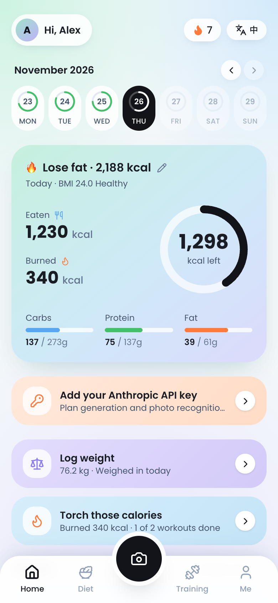<br><sub><b>Home</b>: week strip, kcal-left ring, macros</sub></td>
    <td align="center">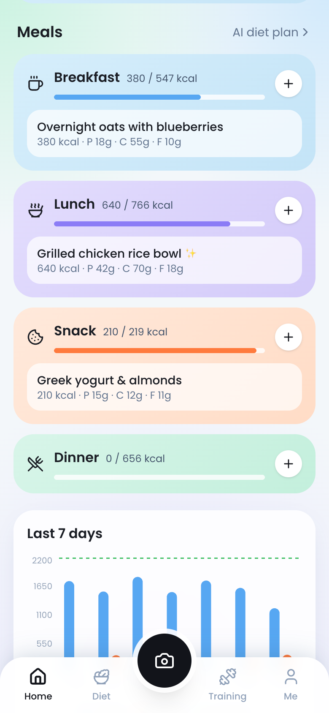<br><sub><b>Meals</b>: per-meal budget and progress</sub></td>
    <td align="center">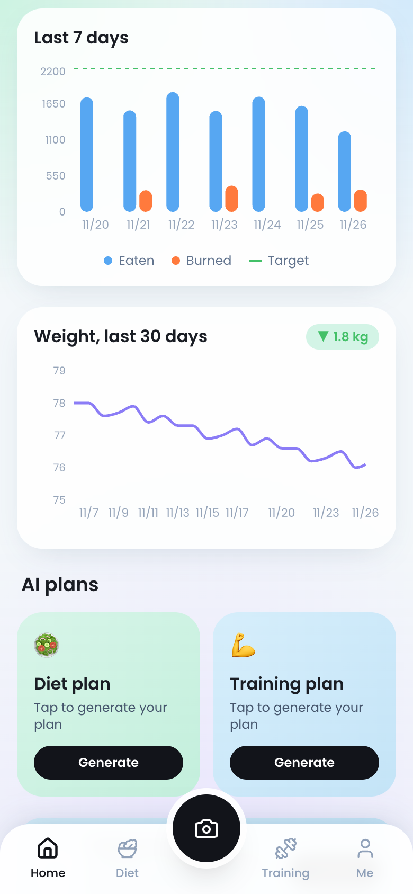<br><sub><b>Trends</b> and AI plans</sub></td>
  </tr>
  <tr>
    <td align="center">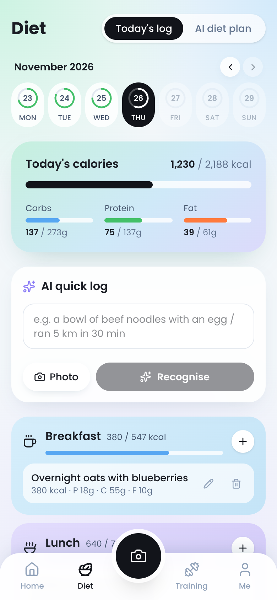<br><sub><b>Diet</b>: browse days, AI quick log, edit entries</sub></td>
    <td align="center">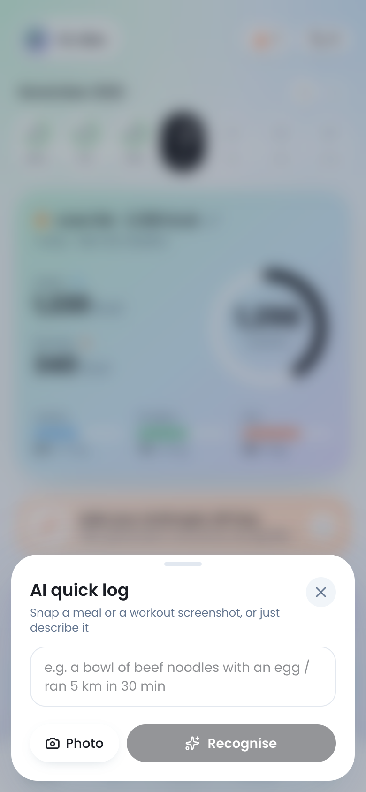<br><sub><b>Camera button</b>: log from any page</sub></td>
    <td align="center">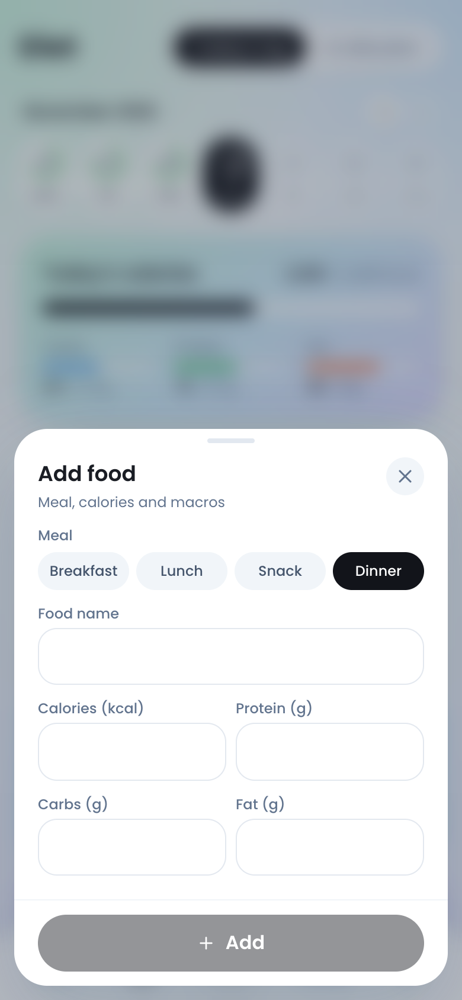<br><sub><b>Manual entry</b>: bottom sheet</sub></td>
  </tr>
  <tr>
    <td align="center">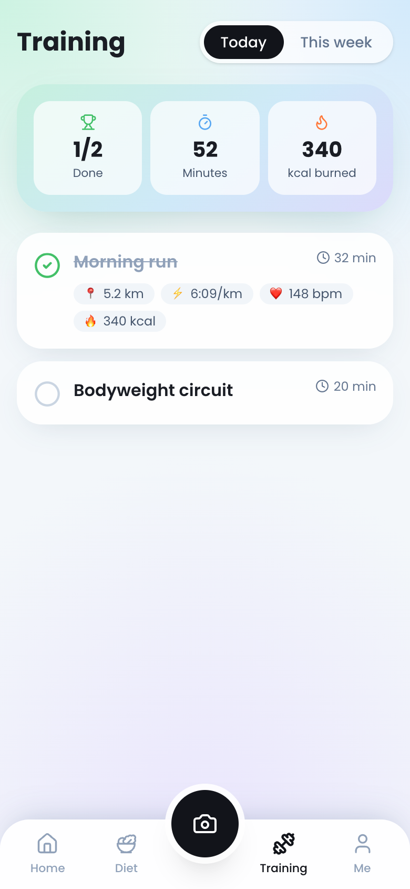<br><sub><b>Training</b>: workouts from screenshots</sub></td>
    <td align="center">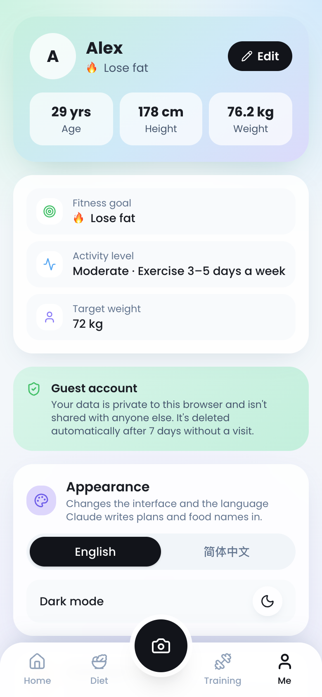<br><sub><b>Me</b>: language, theme, API key, Telegram</sub></td>
    <td align="center">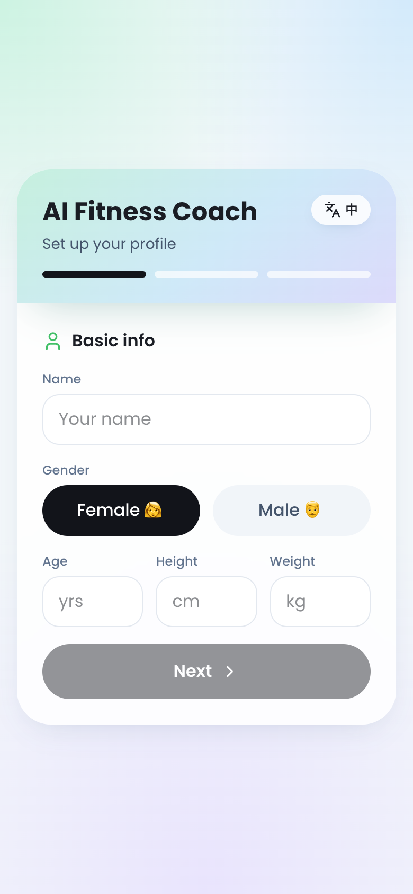<br><sub><b>Setup</b>: 3 steps, no sign-up form</sub></td>
  </tr>
  <tr>
    <td align="center">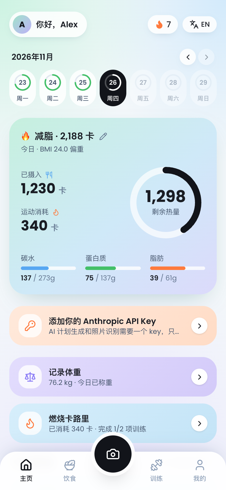<br><sub><b>简体中文</b>: one switch, Claude follows</sub></td>
    <td align="center">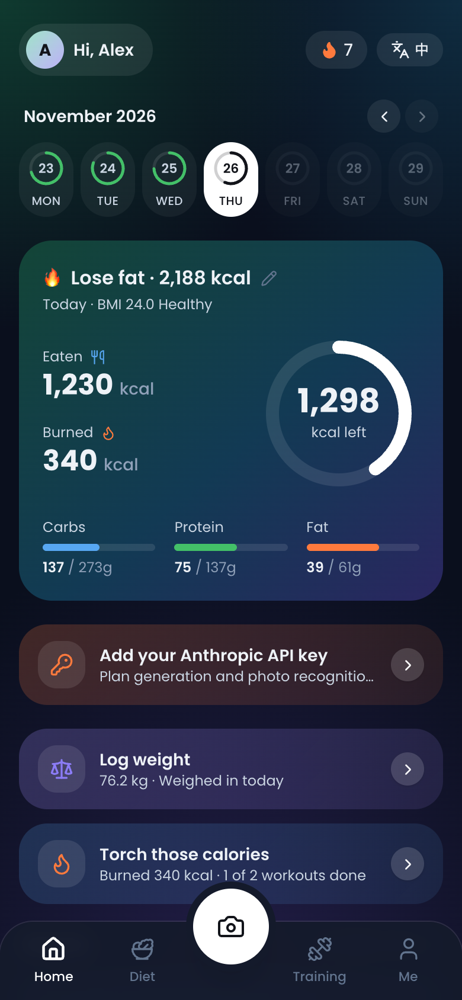<br><sub><b>Dark mode</b>: follows the system or your choice</sub></td>
    <td></td>
  </tr>
</table>

<sub>Screenshots are generated by <a href="scripts/screenshots.mjs"><code>npm run screenshots</code></a>, which signs up a throwaway guest, logs sample meals, workouts and weigh-ins through the app's own API, captures each screen in headless Chrome at iPhone size, and deletes the guest. Re-run it after a UI change.</sub>

### Try it in 2 minutes

1. **Get an Anthropic API key** at [console.anthropic.com](https://console.anthropic.com/settings/keys).
2. **Open the app** and fill in the 3-step profile. On the last step, paste your key and press **Save**. The key is checked with a free Models API call before it's stored.
3. **Diet → AI quick log:** upload a food photo, or type something like "a bowl of beef noodles with an egg". Claude splits it into ingredients, estimates calories and macros with a likely range, and you press **Log it** to save.
   - Add "split for 2" to the caption to see the portion-splitting logic. The model returns totals for the whole dish and the server divides them, so the arithmetic is exact.
   - Upload a screenshot from a running app, or type "ran 5 km in 30 min", and it's logged as a workout instead.
4. **Home → generate a diet or training plan.** Claude writes a 7-day plan based on your height, weight, age, activity level and goal. Plans are limited to one per week; reset under **Me → Data** to generate again.
5. **Dashboard:** calorie ring, macro progress, 7-day intake vs burn chart, weight trend.
6. **Switch language** (the 中 / EN button at the top of Home, or **Me → Appearance**) and generate again: the UI and Claude's output both change.
7. **Optional, Telegram:** under **Me → Telegram bot**, paste a token from [@BotFather](https://t.me/BotFather). The app checks it, registers the webhook, and the bot is live; send it a food photo.

---

## Features

| | |
|---|---|
| 📸 **Photo → nutrition** | Claude vision breaks the meal into components with gram estimates, a confidence score and a calorie range |
| 🏃 **Screenshot → workout** | Reads distance, pace, heart rate and calories from running, cycling or swimming app screenshots |
| ✍️ **Text logging** | Free text like "跑步 5 公里" (ran 5 km) or "一碗拉面" (a bowl of ramen) is classified as food or workout and parsed |
| 📅 **Weekly plans** | Diet plan (daily calories, macros, 7 days × 4 meals) and training plan, from the user's TDEE (Mifflin–St Jeor) |
| 📊 **Dashboard** | Calorie budget, macro ring, 7-day chart, 30-day weight trend |
| ⚖️ **Weigh-ins** | "Log weight" on the dashboard or `/weight 55.2` in Telegram; one entry per day, shows the change since last time, and the latest entry becomes your current weight |
| 🤖 **Telegram bot** | Send photos or text to log; `/today`, `/summary`, `/weight`, `/quick`, and `/chat` for a coach that sees today's intake and your plans |
| 🔑 **Bring your own key** | Per-visitor Anthropic key in localStorage, sent per request; the server key is an optional fallback |
| 🤖 **Connect a bot in the app** | Paste a BotFather token; the server checks it, registers the webhook and stores the secrets encrypted (AES-256-GCM) |
| 🌐 **English / 简体中文** | Typed dictionaries, language from cookie or `Accept-Language`, and Claude replies in the same language |
| 🗓 **Week strip** | Tap any day this week (or earlier weeks) to view and log it; each day's ring shows calories eaten vs target |
| 🔥 **Streak** | Consecutive days with at least one food entry |
| 🌗 Dark mode, mobile-first UI | Pastel mint / aqua / lilac design with black actions; dark mode follows the system until you choose |

## Tech stack

- **Next.js 16** (App Router, Route Handlers, Server Components) · **React 19** · **Tailwind CSS 4**
- **Prisma 6** + **PostgreSQL** (Neon/Supabase work out of the box)
- **Anthropic TypeScript SDK**, model `claude-haiku-4-5` (fast and cheap, which matters when visitors pay)
- **node-telegram-bot-api** in webhook mode, running on serverless functions
- **Recharts** for the charts, **lucide-react** for icons

## Architecture

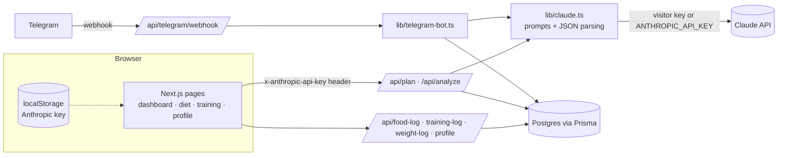

More detail, including design decisions and trade-offs: [docs/ARCHITECTURE.md](docs/ARCHITECTURE.md).

### How bring-your-own-key works

1. [components/ApiKeyCard.tsx](components/ApiKeyCard.tsx) checks the key with `POST /api/ai/status`, which calls the free `models.list` endpoint, then saves it to `localStorage`.
2. AI requests use `aiHeaders()` from [lib/byok-client.ts](lib/byok-client.ts), which adds an `x-anthropic-api-key` header.
3. [lib/api-key.ts](lib/api-key.ts) reads the header. [lib/claude.ts](lib/claude.ts) `getClient(apiKey)` uses the visitor's key, or falls back to `ANTHROPIC_API_KEY`, or throws `MissingApiKeyError`.
4. Errors from the SDK (`AuthenticationError`, `RateLimitError`, …) become clear messages in the UI.

The key is never logged or written to the database. Serve the app over HTTPS in production (Vercel does this by default).

### Why the Telegram bot token is different

When someone messages the bot, Telegram calls the server's webhook directly and no browser is involved, so the bot token **must** be stored on the server. [components/TelegramBotCard.tsx](components/TelegramBotCard.tsx) posts the token, plus the visitor's Anthropic key, to `POST /api/telegram/setup`, which:

1. checks the token with Telegram (`getMe`),
2. registers `/api/telegram/webhook` with a fresh random `secret_token`, so the webhook only accepts calls from Telegram,
3. stores the token, the webhook secret and the Anthropic key encrypted with AES-256-GCM ([lib/crypto.ts](lib/crypto.ts)), using a key derived from `APP_SECRET`, which never touches the database.

**Only the owner's chat can use the bot.** The first private chat to message a newly connected bot claims it, atomically, so if two people race only one wins. After that, everyone else gets a "this bot is private" reply and nothing is logged. Group chats and button presses can't claim a bot. Reconnecting resets the claim. For the env-var bot, list allowed chats in `TELEGRAM_ALLOWED_CHAT_IDS`.

**Disconnect** removes the webhook and deletes the stored secrets. Env vars (`TELEGRAM_BOT_TOKEN`, …) still work as a fallback.

### Languages

The language comes from the `lang` cookie (set by the switcher through a Server Action), then the browser's `Accept-Language`, then English ([lib/i18n/](lib/i18n/)). [lib/i18n/dictionaries/en.ts](lib/i18n/dictionaries/en.ts) defines the shape and [zh.ts](lib/i18n/dictionaries/zh.ts) must match it, so a missing translation is a type error. AI routes pass the locale to `lib/claude.ts`, which tells Claude which language to write in. JSON keys and enums such as training intensity (`low`/`medium`/`high`) stay fixed, so stored data doesn't depend on the language.

## Running locally

Requirements: Node 20+, and a Postgres database (a free [Neon](https://neon.tech) database is the quickest).

```bash
git clone https://github.com/pangeve703/ai-claude-fitness.git
cd ai-claude-fitness
npm install
cp .env.example .env.local      # set DATABASE_URL; ANTHROPIC_API_KEY is optional
npx prisma db push               # create or update the tables
npm run dev                      # http://localhost:3000
```

### Checks

```bash
npm run check     # lint + type check + unit tests
npm run build
```

Unit tests ([tests/](tests/), Vitest) cover the logic that has to be exactly right:
- calendar dates in the app's time zone,
- calorie and macro targets,
- portion splitting ("split for 3", 两人分),
- weight parsing,
- language detection, and that both dictionaries have the same keys,
- secret encryption.

GitHub Actions runs lint, type check, tests and build on every push and pull request ([.github/workflows/ci.yml](.github/workflows/ci.yml)).

| Variable | Required | Purpose |
|---|---|---|
| `DATABASE_URL` | ✅ | Postgres connection string |
| `ANTHROPIC_API_KEY` | – | Server key. If unset, each visitor adds their own in the app. Required for the Telegram bot |
| `APP_SECRET` | for Telegram | Encrypts the stored bot token and key. `openssl rand -hex 32` |
| `APP_URL` | – | Public HTTPS URL used for the webhook (defaults to the request's URL) |
| `ANTHROPIC_IMAGE_MODEL` | – | Override the model used for photo analysis |
| `TELEGRAM_BOT_TOKEN` | – | Bot set through env vars instead of the app |
| `TELEGRAM_WEBHOOK_SECRET` | – | Webhook secret for the env-var bot |
| `TELEGRAM_OWNER_USER_ID` | – | Which user the env-var bot logs for (default `1`) |
| `TELEGRAM_ALLOWED_CHAT_IDS` | – | Chats allowed to use the env-var bot (comma-separated); unset = anyone |
| `APP_TIME_ZONE` | – | Time zone the bot uses for "today" (default `Asia/Singapore`) |

### Deploying (Vercel)

1. Import the repo on Vercel and set `DATABASE_URL` (and any of the optional variables above).
2. Leave `ANTHROPIC_API_KEY` unset on a public demo so visitors use their own keys.
3. For Telegram, set `APP_SECRET`, then connect the bot from **Me → Telegram bot** in the deployed app. Telegram needs a public HTTPS URL, so this doesn't work on `localhost`; use a tunnel and set `APP_URL` if you need it locally.

### Guest accounts: every visitor gets private data

Each visitor gets a **guest account** when they finish setup, with no sign-up form. Their profile, logs, plans, weigh-ins and Telegram bot are visible only to them, so one deployment can be shared with any number of interviewers.

- **Session:** a random 256-bit token in an `httpOnly`, `SameSite=Lax` cookie. Only its SHA-256 hash is stored (`Session` table), so a database leak doesn't expose usable sessions.
- **Every query is scoped to the signed-in user**, including updates and deletes by id. Asking for someone else's record gets the same 404 as a missing one.
- **Delete my account:** guests can delete their account and everything in it from **Me**, at any time.
- **Expiry:** guests are deleted with all their data (`ON DELETE CASCADE`) after 7 days without a visit. Cleanup runs whenever a new guest signs up, so there's no cron job to run.
- **The owner's profile** is a non-guest user that never expires. To sign a browser into it:
  ```bash
  npm run owner-link                                # user 1, for APP_URL or localhost
  npm run owner-link -- 1 https://your-app.vercel.app
  ```
  This prints a one-time link, valid for an hour. It signs you in when you press **Continue**, not on page load, so link previews in chat apps can't use it up.

## Project structure

```
app/
  api/
    ai/status/        GET: is a server key set? POST: check a visitor key
    analyze/          photo/text → food or workout (Claude), nothing saved
    telegram/setup/   GET status · POST connect a bot · DELETE disconnect
    plan/             generate and store weekly diet/training plans
    food-log/ training-log/ weight-log/ profile/ reset/   CRUD
    telegram/webhook/ env-var bot; telegram/webhook/[botId]/ bots connected in the app
  signin/[token]/     one-time sign-in link (scripts/owner-link.mjs)
  dashboard/ diet/ training/ profile/ setup/              pages (server component + *Client.tsx)
components/           NavBar, ApiKeyCard, TelegramBotCard, AiQuickLog, LanguageSwitcher, I18nProvider…
lib/
  claude.ts           all prompts and Claude calls, JSON parsing, portion splitting
  api-key.ts          server-side key handling and localized error mapping
  byok-client.ts      browser-side key storage and headers
  session.ts          guest accounts: session cookie, getCurrentUser(), expiry
  api-auth.ts         apiUser(): 401 for signed-out API calls
  crypto.ts           AES-256-GCM encryption for stored secrets
  dates.ts            "today" and date arithmetic in APP_TIME_ZONE (one definition for web, API and bot)
  nutrition.ts        BMR, TDEE, calorie and macro targets (one definition for dashboard and plans)
  weight.ts           weight parsing; weight-store.ts records weigh-ins
  workouts.ts         calories burned (completed workouts, recorded calories only)
  telegram-access.ts  which chats a bot may serve (claim / allow-list)
  bot-config.ts       bot secrets from the database (encrypted) or env vars
  telegram-api.ts     minimal Telegram Bot API client (getMe, setWebhook…)
  i18n/               locales, typed en/zh dictionaries, getLocale(), setLocale action
  telegram-bot.ts     bot commands, photo/text handlers
  prisma.ts           Prisma client singleton
prisma/schema.prisma  User, Session, FoodLog, TrainingLog, WeightLog, Plan, BotConfig
scripts/owner-link.mjs  one-time sign-in link for an existing user
scripts/screenshots.mjs regenerates docs/demo/ (README screenshots)
tests/                Vitest unit tests
.claude/skills/       Claude Code skills for working on this repo (see below)
docs/                 architecture notes and the demo script
```

## Built with Claude Code

This repo includes [Claude Code skills](https://docs.claude.com/en/docs/claude-code/skills): instructions Claude Code loads when it works on a matching task, so it follows the project's conventions.

| Skill | When it's used |
|---|---|
| [`add-ai-feature`](.claude/skills/add-ai-feature/SKILL.md) | Adding a new Claude-powered capability (prompt → JSON → route → UI) with bring-your-own-key support |
| [`db-schema-change`](.claude/skills/db-schema-change/SKILL.md) | Changing the Prisma schema safely on Postgres |
| [`telegram-command`](.claude/skills/telegram-command/SKILL.md) | Adding a bot command or handler that works with serverless webhooks |
| [`run-app`](.claude/skills/run-app/SKILL.md) | Starting the app and smoke-testing the API, including the bring-your-own-key paths |

[AGENTS.md](AGENTS.md) (loaded through `CLAUDE.md`) gives Claude Code the project overview and rules.

## Roadmap

- Optional real login (e.g. passkeys) so guests can keep their data beyond 7 days
- Structured outputs (`output_config.format`) instead of regex JSON extraction
- Prompt caching for the coach chat context
- Contract tests for the API routes (mocked SDK and database)
- An accuracy check for food recognition: photos with known calories, scored automatically
