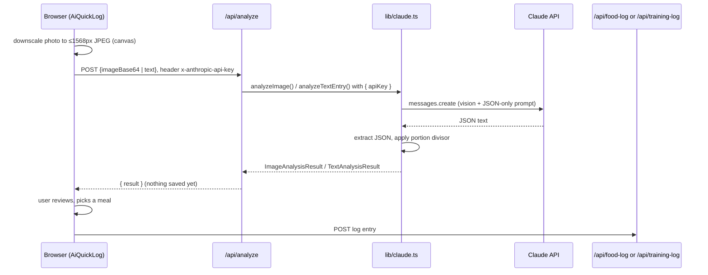

# Architecture & design decisions

## Request flows

### Web: AI quick log (photo or text)

Analysing and saving are separate calls on purpose. The user always sees the estimate and can cancel before anything is written, and `/api/analyze` never writes to the database.

### Telegram

Connecting (`POST /api/telegram/setup`): check the token with `getMe` → `setWebhook` with a fresh random `secret_token` → store token, webhook secret and the visitor's Anthropic key, encrypted, in the `BotConfig` row.

Each message: `POST /api/telegram/webhook/<id>` → `getAppBotConfig(id)` (decrypts that user's row; the plain `/api/telegram/webhook` route serves the env-var bot, owned by `TELEGRAM_OWNER_USER_ID`) → compare the `x-telegram-bot-api-secret-token` header → `getBot(config).processUpdate()` → handlers in `lib/telegram-bot.ts`, which call Claude with the stored key.
The route returns `200` to Telegram immediately and uses Next's `after(awaitInFlight)` to keep the serverless function alive until the handlers (which can take 10–30 s) finish. Every handler is wrapped in `track()` so `awaitInFlight` can wait for it. The config is read on every call, so a newly connected bot works on every serverless instance immediately; the `TelegramBot` instance is cached per token.

### Plan generation

`POST /api/plan {type}` loads the profile, works out TDEE (Mifflin–St Jeor × activity multiplier) and asks Claude for a 7-day JSON plan, which is stored as a `Plan` row. The dashboard allows one plan of each type per week (`dietLockedUntil` / `trainingLockedUntil`).

## Design decisions

**Bring your own key.** The demo is public but the AI costs money. Each visitor's key lives in their own `localStorage` and travels in a header on each AI request (`lib/byok-client.ts` → `lib/api-key.ts` → `getClient(apiKey)`). The server key is only a fallback.
- Why not store keys server-side? There are no user accounts. Storing keys would mean encrypting secrets at rest for anonymous visitors, which adds risk for no benefit.
- A key is checked with `models.list` (free) before it's saved, so a typo shows up immediately instead of on the first plan generation.
- The trade-off: a key in `localStorage` can be read by any script on the page (XSS). That's acceptable for a demo with no third-party scripts; a production app would use server sessions instead.

**Bot secrets live on the server, encrypted.** The web key can stay in the browser because the browser is part of every request. A Telegram message reaches the webhook with no browser involved, so the bot token, and the Anthropic key the bot uses, have to be stored on the server. They're encrypted with AES-256-GCM (random IV per value, auth tag detects tampering), using a key from `APP_SECRET`, which lives only in the environment. A database leak alone doesn't expose them. Status endpoints never decrypt, and disconnecting deletes the row.
- **Chat lock.** A bot serves one Telegram chat. The webhook checks every update against `chatLock` before the bot sees it (`lib/telegram-access.ts`, a pure function with its own tests). A new bot is *claimable*: the first private-chat **message** claims it with `UPDATE … WHERE chatId IS NULL`, so a race has exactly one winner. Groups and button presses can't claim. Strangers get a 200 (so Telegram doesn't retry) and, in private chats, a short "this bot is private" reply. Reconnecting resets `chatId`. The env-var bot uses `TELEGRAM_ALLOWED_CHAT_IDS`.
- Each user has at most one bot (`BotConfig.userId` is unique). Its webhook path uses the row's random 96-bit id, and the bot's handlers carry that user's id, so every query the bot makes is scoped to its owner. A forged "delete" button press can't remove someone else's entry.

**Languages via cookie, not URL.** The Next guide's `/[lang]/…` routing suits public, indexable pages. This is a private dashboard where every page is already rendered on request, so the locale comes from a cookie (or `Accept-Language`) and URLs stay the same. Only the locale string crosses into Client Components; both dictionaries are bundled because they contain functions (`entries(n)`) and are small. Prompts stay in Chinese and a single "write in X" rule sets the output language, so there's one prompt per task instead of two to keep in sync. Enums Claude returns (`intensity: low|medium|high`) stay language-neutral and the UI translates them.

**One definition of "today".** Logs are keyed by calendar date (`YYYY-MM-DD`) in `APP_TIME_ZONE`, and every caller uses `lib/dates.ts`: pages, routes, the plan lock and the bot. Earlier, web routes used `toISOString()` (UTC) while the bot used local time, so in Singapore anything logged on the web before 8am went under yesterday. The helpers work on date strings, not `Date` objects, so neither the server's time zone nor daylight saving can shift a day. The weekday that highlights "today" in the weekly plans also comes from the server, not the browser's clock.

**One definition of the calorie target.** `lib/nutrition.ts` computes BMR, TDEE, the goal adjustment (−500 / +300 kcal, never below 1,200) and the default macros. The dashboard and the diet-plan prompt both use it, and after Claude answers, the code writes the computed target and macros into the plan. Claude plans meals around the number; it doesn't choose it.

**Weigh-ins.** `recordWeight()` stores one entry per day (a repeat the same day overwrites it). In the same transaction, if the entry is the newest, it becomes the profile weight, so the calorie target and future plans use the latest number. The dashboard, the profile form and Telegram's `/weight` all call it.

**One design system.** `app/globals.css` defines the palette as Tailwind tokens and a handful of surface classes (`.card`, `.card-hero`, `.tint-*`, `.btn-ink`, `.field`), each with its dark variant, so pages carry layout, not colour decisions. The theme is applied by an inline script in `<head>` before first paint (saved choice, else the OS setting), so there's no light flash and no page depends on the toggle being mounted. Reusable pieces (week strip with per-day calorie rings, calorie ring, macro bars, meal card) are in `components/ui/`. Screenshots are regenerated with `npm run screenshots` and reviewed after UI changes; that review caught several of the bugs fixed in this version (mismatched calorie targets, a hidden chart target line, dark mode only working on one page).

**Input validation.** The log routes check every field (`lib/validate.ts`: known meal, non-empty name, finite non-negative numbers within sensible limits, no future dates) and answer 400 with the field name. Values from Claude are rounded and trimmed before saving.

**BMI by audience.** English uses WHO cut-offs (25 / 30), Chinese uses China's WS/T 428 cut-offs (24 / 28), selected by `bmiStandard` in each dictionary.

**Haiku for everything.** Food estimation and plan writing don't need a frontier model, and visitors pay for their own calls. Photo analysis can be switched to another model with `ANTHROPIC_IMAGE_MODEL`.

**Deterministic maths stays in code.** When a caption says "split for 3" (`分成3份`, `3人份`, `shared by 3 people`…), `getServingDivisor()` parses the number, the prompt tells Claude to return totals for the **whole** dish, and `divideFoodResult()` does the division. Models are unreliable at arithmetic hidden inside a prompt; regex plus division always gives the same answer.

**Splitting meals into components.** The vision prompt asks for per-ingredient grams, macros and confidence, plus a calorie *range*. Breaking the dish down makes Claude account for hidden calories (oil, sauces, batter) that a single overall guess misses, and the range tells the user how uncertain the estimate is.

**JSON from free text.** Prompts say "output JSON only" and the code extracts the first `{…}` block, returning `{type: "unknown"}` if parsing fails. This is simple and robust enough for Haiku. The next step is structured outputs (`output_config.format`), which guarantee the response matches a schema.

**Guest accounts instead of login.** Interviewers should be able to try the app in seconds without seeing each other's data. Finishing setup creates a guest user and a session: a random token in an `httpOnly` cookie, stored only as its SHA-256 hash. `getCurrentUser()` (cached per request with React `cache`) resolves it, so pages use `requireUser()` and API routes use `apiUser()`. Every query filters by `userId`, including update and delete by id, and someone else's record looks the same as a missing one (404).
- Guests expire after 7 days without a visit and are deleted with everything they own (`ON DELETE CASCADE`). The cleanup runs when a new guest signs up, so no cron job is needed. `lastSeenAt` is written at most once an hour, so ordinary browsing doesn't write to the database on every page.
- The original profile is a non-guest user (`isGuest` defaults to `false`, so the migration couldn't accidentally make it expire). `npm run owner-link` creates a one-time sign-in link. It's redeemed by a button (a Server Action), not on page load, because chat apps fetch links to build previews and would use up a GET link.
- Covered by `tests/ownership.test.ts` (routes with a mocked database) and `tests/session.test.ts`.

**Server components + client islands.** Each page's `page.tsx` reads Prisma directly and passes plain props to a `*Client.tsx` component for interactivity. Writes go through route handlers, which call `revalidatePath`, and the client calls `router.refresh()`.

## Data model

| Model | Notes |
|---|---|
| `User` | Body stats, goal, `isGuest`, `lastSeenAt`. Deleting a user deletes everything below |
| `Session` | SHA-256 of the session token, `userId`, `claimedAt` (for one-time links) |
| `FoodLog` | `date` is a `YYYY-MM-DD` string; `source` is `manual` / `telegram` / `telegram_quick` / `web_ai` |
| `TrainingLog` | `notes` holds JSON (`distance`, `pace`, `heartRate`, `caloriesBurned`, `details`) when it comes from AI |
| `WeightLog` | At most one row per day (an update replaces it); written only through `recordWeight()` |
| `Plan` | `type` is `diet` or `training`; `content` is the plan JSON from Claude |
| `BotConfig` | One per user: random id (webhook path), encrypted bot token, webhook secret and Anthropic key, bot username, claimed `chatId` |

## Error handling for AI calls

`aiErrorResponse()` in `lib/api-key.ts` maps errors to HTTP responses using the SDK's typed error classes rather than matching on message text:

| Error | HTTP | `code` |
|---|---|---|
| `MissingApiKeyError` (no visitor key and no server key) | 401 | `missing_api_key` |
| `Anthropic.AuthenticationError` | 401 | `invalid_api_key` |
| `Anthropic.PermissionDeniedError` | 403 | `permission_denied` |
| `Anthropic.RateLimitError` | 429 | `rate_limited` |
| other `Anthropic.APIError` | 502 | – |
